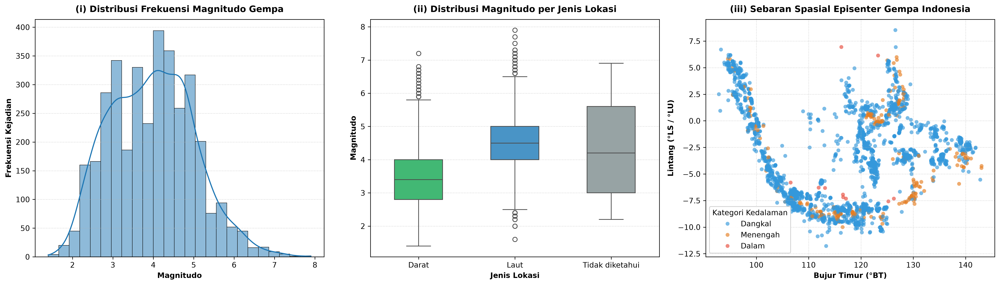

# DV-08-BMKG-EARTHQUAKE-ANALYSIS

# Ujian Tengah Semester (UTS) - Visualisasi Data
**Studi Kasus:** Analisis dan Visualisasi Spasial-Statistik Gempa Bumi Dirasakan di Indonesia (Data BMKG s.d. 13 Oktober 2026)

---

## 📌 Identitas Mahasiswa
* **Nama Lengkap:** Gathan Hilabi
* **NIM:** 60324059
* **Kelas:** Visualisasi Data (A)
* **Program Studi:** S1 Informatika
* **Institusi:** Universitas Islam Negeri K.H. Abdurrahman Wahid Pekalongan
* **Tahun Akademik:** 2026/2027

---

## 📂 Struktur Direktori Proyek

```text
VD/
│
├── Soal UTS Visualisasi Data Gempa BMKG_60324059.pdf  # Dokumen soal panduan praktikum UTS
├── UTS_60324059_GathanHilabi_VD(A).ipynb            # Notebook utama analisis & visualisasi data
├── dataset_UTS_gempa_dirasakan_bmkg.csv              # Dataset gempa dirasakan BMKG (sumber data)
├── uts_grafik.png                                    # Gambar output visualisasi 3 panel (Seaborn)
└── README.md                                         # Dokumentasi proyek praktikum UTS
```

---

## 📖 Ringkasan Isi dan Analisis Notebook

Notebook [`UTS_60324059_GathanHilabi_VD(A).ipynb`](UTS_60324059_GathanHilabi_VD(A).ipynb) disusun secara runtut sesuai indikator penilaian pada soal UTS:

### 1. B1. Memuat dan Memahami Data (Data Exploration)
* **Pemuatan Data:** Membaca file `dataset_UTS_gempa_dirasakan_bmkg.csv` ke dalam DataFrame `df`.
* **Inspeksi Awal:**
  * Menampilkan dimensi data (`shape`), 5 baris pertama data (`head()`), serta ringkasan struktur dan tipe data (`info()`).
  * Mengecek keberadaan *missing values* (nilai kosong) pada tiap atribut kolom.

### 2. B2. Pembersihan Data (Data Cleaning & Quality Assurance)
* **Langkah 1:** Membuang baris anomali dengan label `catatan_kualitas == "FUTURE_EARTHQUAKE"`.
* **Langkah 2:** Menjalankan statistik deskriptif koordinat (`lintang` & `bujur`), mendeteksi dan membuang koordinat tidak valid/mustahil di luar batas geografis kepulauan Indonesia ($90^\circ\text{ BT} - 145^\circ\text{ BT}$).
* **Langkah 3:** Melakukan audit duplikasi baris berdasarkan kolom `id_gempa`.
* **Langkah 4:** Melakukan imputasi (*handling missing values*) pada kolom `jenis_lokasi` menggunakan nilai default `'Tidak diketahui'`.
* **Hasil Akhir:** Menghasilkan DataFrame `df_bersih` yang siap untuk diproses lebih lanjut.

### 3. B3. Statistik Deskriptif, Feature Engineering, dan Outlier
* **Kategorisasi Kedalaman:** Membuat fungsi `kategori_kedalaman(km)` sesuai standar seismologi:
  * **Dangkal:** $< 60\text{ km}$
  * **Menengah:** $60 - 300\text{ km}$
  * **Dalam:** $> 300\text{ km}$
* **Statistik Kedalaman & Magnitudo:** Menghitung ukuran pemusatan data (*mean* dan *median*) serta sebaran kuartil.
* **Agregasi Tahunan:** Mengelompokkan kejadian per tahun (`groupby('tahun')`) untuk melihat tren frekuensi dan rata-rata kekuatan gempa.
* **Pivot Table:** Menyusun tabel kontingensi frekuensi silang `jenis_lokasi` terhadap `kategori_kedalaman`.
* **Deteksi Outlier:** Menggunakan metode **Interquartile Range (IQR)** pada magnitudo:
  * Menentukan kuartil bawah ($Q_1$), kuartil atas ($Q_3$), $IQR = Q_3 - Q_1$, dan batas atas outlier ($Q_3 + 1.5 \times IQR$).
  * Mengidentifikasi gempa signifikan seperti **Gempa Nagekeo (M7.0)** sebagai kejadian outlier statistik.

### 4. B4. Visualisasi Data (Matplotlib & Seaborn)
* **B4.1 Bar Chart Matplotlib (Jumlah Kejadian per Bulan pada Tahun 2026):**
  * Menampilkan bar chart Januari s.d. Oktober 2026.
  * Memberikan *highlighting* warna kontras (merah) pada batang bulan **Agustus 2026** (bulan dengan lonjakan aktivitas seismik tertinggi).
  * Menambahkan label nilai tepat di atas batang serta kotak anotasi penjelas yang menunjuk ke puncak kejadian tanpa menghalangi angka.
* **B4.2 Tiga Panel Seaborn (1 Baris $\times$ 3 Kolom):**
  * **Panel 1 (Histogram & KDE):** Distribusi frekuensi magnitudo gempa dengan kurva estimasi densitas kernel (*Kernel Density Estimation*).
  * **Panel 2 (Boxplot Magnitudo per Jenis Lokasi):** Perbandingan sebaran dan median magnitudo pada kategori Darat, Laut, dan Tidak diketahui.
  * **Panel 3 (Scatter Plot Spasial Episenter):** Pemetaan koordinat spasial (Bujur Timur vs Lintang) di seluruh wilayah Indonesia dengan gradasi warna berdasarkan kategori kedalaman gempa.
  * *Disimpan otomatis ke berkas [`uts_grafik.png`](uts_grafik.png) dengan resolusi tinggi (300 DPI).*

### 5. B5. Korelasi dan Interpretasi Kritis Seismologi
* **B5.1 Heatmap Matriks Korelasi Pearson:**
  * Memetakan derajat hubungan linear antar variabel numerik (`magnitudo`, `kedalaman_km`, `lintang`, dan `bujur`).
  * Mengidentifikasi pasangan parameter dengan nilai koefisien korelasi ($r$) terkuat beserta interpretasi fisik-geologisnya.
* **B5.2 Analisis Spasial Klaster Flores (Agustus 2026):**
  * Memfilter koordinat klaster seismik aktif di sekitar busur Flores (Lintang $[-9^\circ, -7^\circ]$ dan Bujur $[120^\circ, 123^\circ]$).
  * Mengukur persentase kontribusi aktivitas gempa Nagekeo dan deretan gempa susulannya (*aftershocks*) terhadap total kejadian gempa nasional pada Agustus 2026.

---

## 🛠️ Prasyarat dan Kebutuhan Sistem

### Dependensi Python
Proyek ini berjalan pada **Python 3.10+** (telah diuji pada Python 3.14.x) dengan pustaka:
* `pandas` ($\ge 2.0.0$)
* `numpy` ($\ge 1.24.0$)
* `matplotlib` ($\ge 3.8.0$)
* `seaborn` ($\ge 0.13.0$)
* `ipykernel` & `notebook` / `jupyterlab`

---

## 🚀 Panduan Instalasi dan Menjalankan Notebook

### Opsi 1: Menjalankan di Komputer Lokal (VS Code / Antigravity IDE)

1. **Buka Terminal / PowerShell di folder proyek:**
   ```powershell
   cd "c:\Users\LabIoT_01\Downloads\VD"
   ```

2. **Instal Pustaka yang Diperlukan:**
   ```powershell
   pip install pandas matplotlib seaborn notebook ipywidgets
   ```

3. **Buka dan Jalankan Notebook:**
   * Buka folder di **Visual Studio Code** atau **Antigravity IDE**.
   * Buka file `UTS_60324059_GathanHilabi_VD(A).ipynb`.
   * Pada pojok kanan atas editor, pilih kernel Python yang aktif (misalnya `Python 3.14 (UTS)`).
   * Klik **Run All** (Jalankan Semua Sel).

> **Catatan Kompatibilitas Lokal:** 
> Modul cell pertama menggunakan `from google.colab import files`. Di lingkungan lokal, sistem telah dilengkapi *shim/fallback* otomatis sehingga fungsi `files.upload()` akan langsung mengenali dan membaca berkas lokal `dataset_UTS_gempa_dirasakan_bmkg.csv` tanpa memicu error.

---

### Opsi 2: Menjalankan melalui Jupyter Notebook (Web Browser)

Jalankan perintah berikut di terminal:
```powershell
python -m notebook UTS_60324059_GathanHilabi_VD(A).ipynb
```
Browser akan otomatis terbuka. Pilih menu **Kernel** $\rightarrow$ **Restart & Run All**.

---

### Opsi 3: Menjalankan di Google Colaboratory

1. Buka browser dan kunjungi [Google Colab](https://colab.research.google.com/).
2. Pilih tab **Upload** dan unggah berkas `UTS_60324059_GathanHilabi_VD(A).ipynb`.
3. Jalankan sel pertama (**Sel awal**). Saat tombol *Choose Files* muncul, unggah berkas `dataset_UTS_gempa_dirasakan_bmkg.csv`.
4. Jalankan sel-sel berikutnya secara berurutan hingga selesai.

---

## 📊 Hasil Visualisasi Utama

Visualisasi tiga panel komprehensif yang dihasilkan dari Bagian B4 disimpan sebagai file gambar berikut:



---

## 📜 Lisensi & Catatan Akademik
Proyek ini dibuat untuk pemenuhan tugas **Ujian Tengah Semester (UTS) Praktik Mandiri Mata Kuliah Visualisasi Data**, Program Studi S1 Informatika, Fakultas Sains dan Teknologi, UIN K.H. Abdurrahman Wahid Pekalongan.
